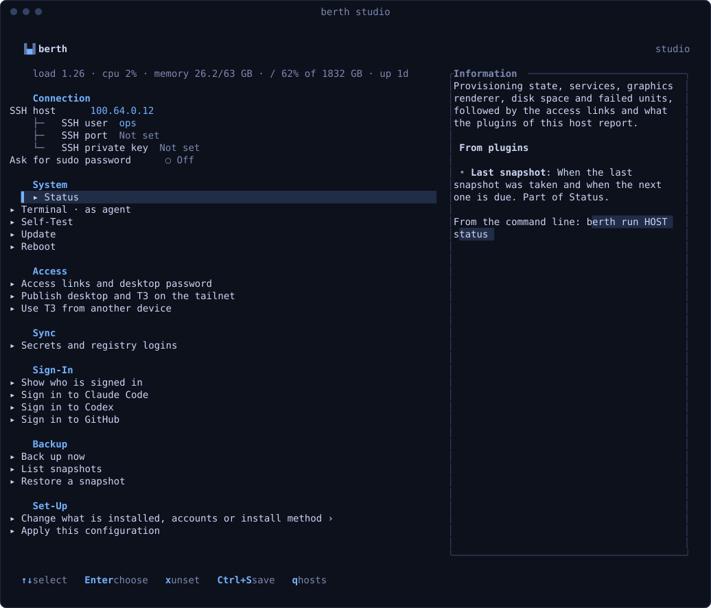

# berth

berth turns a spare laptop, a server or a container into an Ubuntu 26.04 desktop
for coding agents, and looks after it from your terminal.

Each host gets XFCE on a virtual display you open in the browser. Claude Code,
Codex and Pi come with T3 Code as their web front end, along with development
toolchains, Tailscale and Cockpit. berth keeps a profile per host and installs
it. Afterwards every host has a page for status, sign-ins, updates and secrets.



**Status:** early. Try a profile in the container or a VM before booting the
installer on real hardware: **the installer erases the disk it selects.**

## Install

On Linux x86_64:

```bash
curl -fsSL https://raw.githubusercontent.com/helightdev/berth/main/install.sh | sh
```

The script installs the latest release to `~/.local/bin` after checking its
SHA-256. On other architectures, build it:

```bash
rustup target add x86_64-unknown-linux-musl
cargo install --locked --git https://github.com/helightdev/berth berth
```

Setting up hosts also needs `ssh`, `python3` and `ansible-playbook` on your
machine. berth is also an image, `ghcr.io/helightdev/berth`, which runs its
local API server by default.

## Quick start

```bash
berth studio          # a new profile: choose features, accounts and how to install
berth                 # the home screen with all hosts
berth run studio status
```

On a new host's Install tab, choose how to install it. The methods are a USB
installer, a cloud-init seed, SSH to an existing Ubuntu server, and a container
image. Once it runs, `berth studio` opens its overview, where you sign the
agents in and find the address of its desktop.

## Documentation

The documentation site is built from [`docs/`](docs) (`cd docs && npm install && npm run dev`).

- [Getting started](docs/content/docs/%28guide%29/start/install.mdx): installing berth and a first host.
- [Deploying](docs/content/docs/%28guide%29/deploy/index.mdx): the install methods, and testing in QEMU.
- [Using berth](docs/content/docs/%28guide%29/use/index.mdx): the terminal UI and commands, sign-ins, secrets and updates.
- [Extending](docs/content/docs/%28guide%29/extend/index.mdx): plugins, services and `berth serve`.
- [Reference](docs/content/docs/%28guide%29/reference/index.mdx): tools, `box`, profile fields, building and releasing.
- The API reference of berthd and `berth serve`, generated from [`docs/openapi/`](docs/openapi).

## License

MIT, see [LICENSE](LICENSE). The vendored `tui-input` crate under `cli/vendor`
has its own MIT license.
